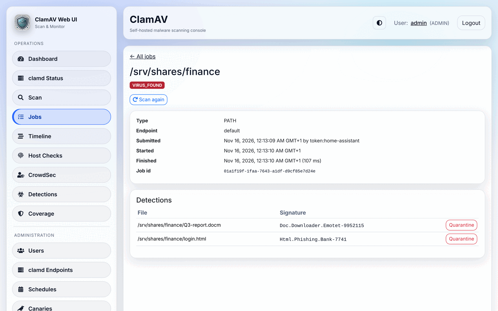
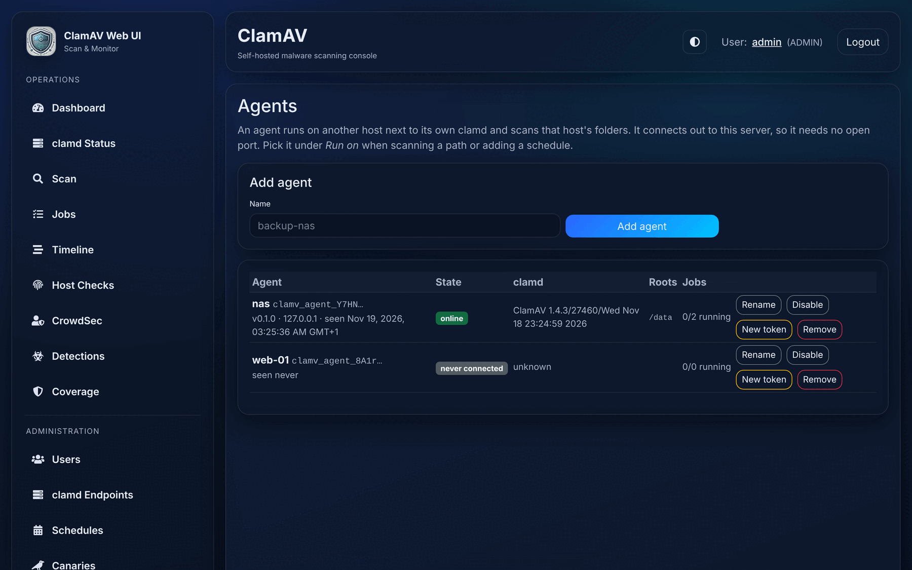

# Palisade

[](https://github.com/keyxmakerx/palisade/actions/workflows/rust.yml)
[](LICENSE)
[](https://github.com/keyxmakerx/palisade/pkgs/container/palisade)

A small, self-hosted web console and API for [ClamAV](https://www.clamav.net/). Scan uploads and folders, schedule and watch them, and see every host's results in one place. Written in Rust, shipped as one static binary in a distroless image.

<picture>
  <source media="(prefers-color-scheme: dark)" srcset="docs/images/dashboard-dark.png">
  
</picture>

## Highlights

- **Scan anything clamd can reach.** Uploads are streamed straight to clamd and never touch the disk. Path scans stay inside the folders you allow.
- **Schedules and watched folders.** Use cron in your own time zone, with an optional night-time window and folders to skip. Each run checks clamd against EICAR first, so a broken scanner shows up as a failure instead of a clean result. Watched folders scan new files the moment they are written.
- **Many hosts, one UI.** Run the same image as an agent on other machines. Agents connect out over pinned HTTPS, so they need no open port. Each one enforces its own limits and keeps its results while the server is away.
- **Beyond file scans.** Canary files, AIDE and rkhunter reports, Falco alerts and a CrowdSec console all feed one timeline. Two sensors firing on the same host make an incident.
- **Alerts where you look.** Send them to webhooks, Discord, Slack, Mattermost, ntfy or Gotify. Prometheus metrics come with Grafana dashboards, and every event is also a structured log line.
- **Secure by default.** You get passkeys and TOTP, OIDC and LDAP with roles from groups, and scoped API tokens. Pages use a strict CSP. The container runs read-only and unprivileged, and the app never moves or deletes a file unless you turn quarantine on.
- **Scriptable.** A JSON API with an OpenAPI spec, the `clamctl` CLI and an MCP server for AI assistants.
- **Your database.** SQLite out of the box, or PostgreSQL, MySQL or MariaDB.

| | |
|---|---|
|  |  |
| **Job detail**: every detection with its signature, plus scan again or quarantine | **Detections**: every infected file on every host, searchable and exportable |
|  |  |
| **Agents**: status, versions and setup for each remote host | **Timeline**: detections, canary hits and sensor alerts from every host in one list |

## Quick start

```sh
docker compose up -d
```

That is all the setup [docker-compose.yml](docker-compose.yml) needs. It runs Palisade next to its own clamd, keeps its data in a Docker volume, and scans what you put in `./scan`.

1. Open http://localhost:8080.
2. Copy the first `admin` password to a file you own. It is never printed:
   `docker compose cp palisade:/app/data/bootstrap-admin-password ./admin-password`
3. Sign in as `admin` and choose a new password. Palisade removes its copy shortly after; delete `./admin-password` too.
4. Open **Admin > Setup**. It shows what works, what is missing, and how to turn it on.

To choose the first password yourself, put it in a file and set `BOOTSTRAP_ADMIN_PASSWORD_FILE` to it (for example as a Docker secret) before the first start.

clamd loads its signatures on first start, which can take a few minutes. Until then Palisade shows it as unreachable, and the log says `clamd.ready` once it answers. If a container keeps restarting, `docker compose logs palisade` names the setting at fault and how to fix it.

Lost the admin password? Run `docker compose exec palisade /app/palisade reset-admin`, then copy the new one out with the command from step 2.

### Minimal or full

| Feature | `docker-compose.yml` | `docker-compose.full.yml` |
|---|---|---|
| Uploads, folder scans, schedules, watched folders | Yes | Yes |
| HTTPS (self-signed; agents need it) | No | Yes |
| CrowdSec console | No | Yes, watcher set up for you |
| Quarantine | No | Yes, once `./scan` is writable by UID 10001 |
| Prometheus `/metrics` | No | Yes, token generated for you |
| Canary file | No | Yes, `./canary/passwords.kdbx` |
| Alerts (webhook, ntfy, Slack, ...) | No | Uncomment the webhook lines |
| AIDE, rkhunter, Falco, auditd | No | Uncomment once the host has them |

For the full set, run `docker compose -f docker-compose.full.yml up -d`, or save that file as `docker-compose.yml`. Both files use the same volume, so you keep your data when you switch. The full file generates its own passwords into a volume, so it needs no preparation either. To use a clamd you already run, start from [docker-compose.external-clamd.yml](docker-compose.external-clamd.yml).

### Turning on more features

These match the items on **Admin > Setup**. Each one is an environment variable on the `palisade` service; restart with `docker compose up -d` after a change.

- **Folders to scan**: mount them read-only and list them in `SCAN_ROOTS`, e.g. `- /srv/media:/srv/media:ro` and `SCAN_ROOTS: /scan,/srv/media`. Mount them into the clamav container at the same path too.
- **HTTPS**: `TLS_SELF_SIGNED: "true"`, plus `TLS_SELF_SIGNED_NAMES` with the names you browse to. Or use a [reverse proxy](docs/REVERSE_PROXY.md) and set `PUBLIC_URL`.
- **Passkeys**: HTTPS with a certificate your browser trusts (a reverse proxy is easiest) and `PUBLIC_URL`, since passkeys are tied to its host name.
- **Alerts**: put your destinations in a file and set `WEBHOOK_URL_FILE` ([formats](docs/CONFIGURATION.md#alerts-webhook-ntfy-gotify-slack-discord)).
- **CrowdSec**: copy the `crowdsec` and `secrets-init` services from the full file. They register Palisade's watcher for you.
- **Quarantine**: `QUARANTINE_DIR: /app/data/quarantine`, and mount the scan folder read-write.
- **Metrics**: `METRICS_TOKEN_FILE` with a token of 16 or more characters.
- **Canaries**: add decoy files on the **Canaries** page, or list them in `CANARY_FILES`.
- **AIDE, rkhunter, Falco**: install them on the host, then mount their logs read-only ([details](docs/CONFIGURATION.md#managed-host-checks-and-firewall)).
- **Sign-in with SSO or LDAP**: see [OIDC](docs/CONFIGURATION.md#oidc-single-sign-on) and [LDAP](docs/CONFIGURATION.md#ldap).
- **Other hosts**: see [Agents](#agents) below.

### Backups

The `palisade-data` volume holds everything Palisade keeps: the database, `secret.key` (it encrypts 2FA secrets), the TLS certificate that agents pin, and quarantined files. Copy it out while Palisade is stopped, and keep the copy private:

```sh
docker compose stop palisade
docker compose cp palisade:/app/data ./palisade-backup
docker compose start palisade
```

With `DATABASE_URL` pointing at PostgreSQL, MySQL or MariaDB, back up that database as well.

## Agents

1. Turn on HTTPS on the server (`TLS_SELF_SIGNED=true` is enough), then add an agent under **Admin > Agents**. The page shows its token once, plus a ready-made compose file.
2. On the other host, save the token as `./agent_token` (owner `10001`, mode `600`) and start `docker-compose.agent.yml` next to a clamd. The agent logs `agent.connected` once it reaches the server.
3. Choose the agent under **Run on** when you scan a path or add a schedule.

Each agent scans only its own `SCAN_ROOTS`, and does only what its host allows in `AGENT_ALLOW`. The server cannot widen either. Every agent setting is listed in [Configuration](docs/CONFIGURATION.md#agents).

## Documentation

| | |
|---|---|
| [Configuration](docs/CONFIGURATION.md) | Every setting, plus clamd limits, alerts, CrowdSec, host checks, quarantine, SSO, metrics and the security model |
| [Architecture](docs/ARCHITECTURE.md) | How the server, agents, jobs and database fit together |
| [Security](docs/SECURITY.md) | Sign-in hardening, step-up confirmation and what to do when locked out |
| [Reverse proxy](docs/REVERSE_PROXY.md) | Running behind Caddy, nginx or Traefik |
| [CLI](docs/CLI.md) and [MCP](docs/MCP.md) | `clamctl` and its MCP server |
| [Grafana and Prometheus](dashboards/) | Dashboard, scrape config and alert rules |

## Building

```sh
cargo build --release      # binary at target/release/palisade
cargo test                 # SQLite; set TEST_DATABASE_URLS to also test the other databases
docker build -t palisade .
```

CI publishes `ghcr.io/keyxmakerx/palisade:latest` from `main`. Release steps and migration rules are in [Configuration](docs/CONFIGURATION.md#building-and-releases).

## License

LGPL-2.1-or-later (see [LICENSE](LICENSE) and [NOTICE](NOTICE)). This is a fork of an earlier Java application, which it has replaced entirely. Report vulnerabilities privately through GitHub security advisories.
