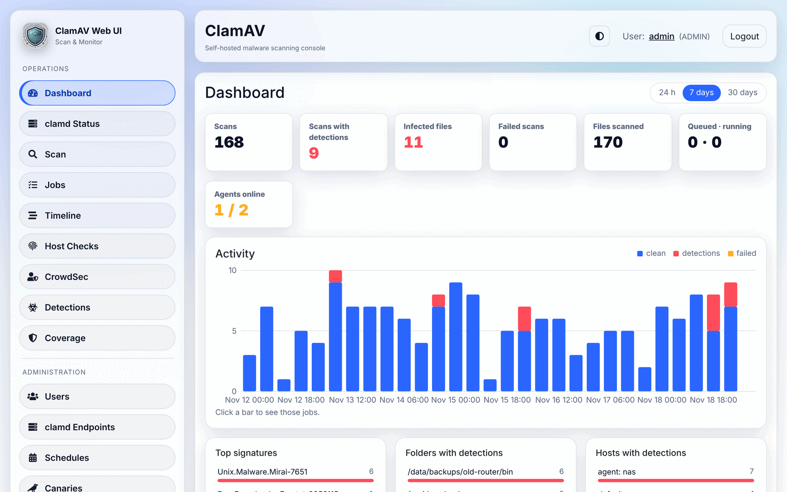
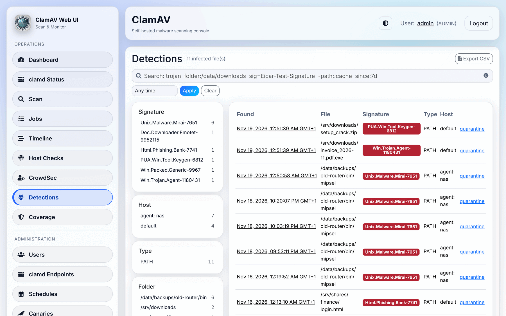
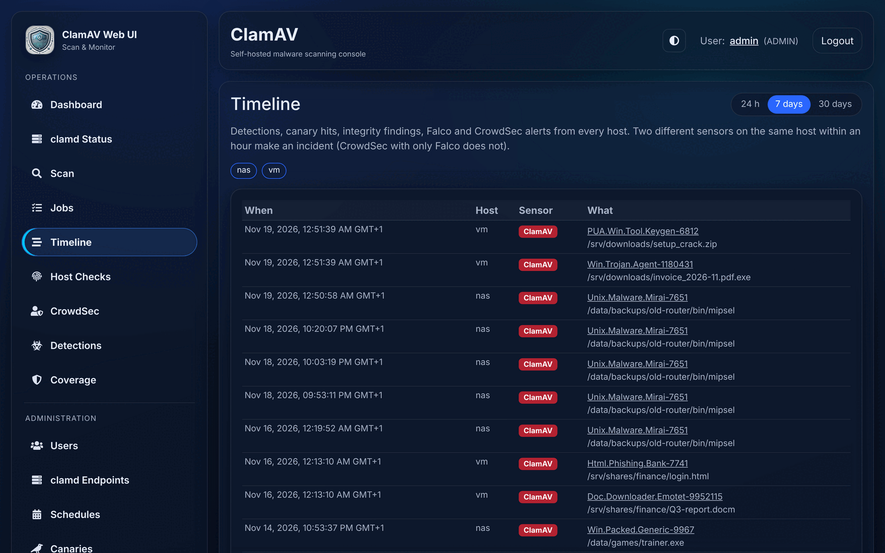

# Palisade

[](https://github.com/keyxmakerx/palisade/actions/workflows/rust.yml)
[](LICENSE)
[](https://github.com/keyxmakerx/palisade/pkgs/container/palisade)

A small, self-hosted web console and API for [ClamAV](https://www.clamav.net/). Scan uploads and folders, schedule and watch them, and see every host's results in one place. Written in Rust, shipped as one static binary in a distroless image.

<picture>
  <source media="(prefers-color-scheme: dark)" srcset="docs/images/dashboard-dark.png">
  
</picture>

## Highlights

- **Scan anything clamd can reach.** Uploads are streamed straight to clamd and never touch the disk. Path scans stay inside the folders you allow.
- **Schedules and watched folders.** Use cron in your own time zone, with an optional night-time window and folders to skip. Each run checks clamd against EICAR first, so a broken scanner shows up as a failure instead of a clean result. Watched folders scan new files the moment they are written.
- **Many hosts, one UI.** Run the same image as an agent on other machines. Agents connect out over pinned HTTPS, so they need no open port. Each one enforces its own limits and keeps its results while the server is away.
- **Beyond file scans.** Canary files, AIDE and rkhunter reports, Falco alerts and a CrowdSec console all feed one timeline. Two sensors firing on the same host make an incident.
- **Alerts where you look.** Send them to webhooks, Discord, Slack, Mattermost, ntfy or Gotify. Prometheus metrics come with Grafana dashboards, and every event is also a structured log line.
- **Secure by default.** You get passkeys and TOTP, OIDC and LDAP with roles from groups, and scoped API tokens. Pages use a strict CSP. The container runs read-only and unprivileged, and the app never moves or deletes a file unless you turn quarantine on.
- **Scriptable.** A JSON API with an OpenAPI spec, the `clamctl` CLI and an MCP server for AI assistants.
- **Your database.** SQLite out of the box, or PostgreSQL, MySQL or MariaDB.

| | |
|---|---|
|  |  |
| **Job detail**: every detection with its signature, plus scan again or quarantine | **Detections**: every infected file on every host, searchable and exportable |
|  |  |
| **Agents**: status, versions and setup for each remote host | **Timeline**: detections, canary hits and sensor alerts from every host in one list |

## Quick start

`docker-compose.yml` runs the UI next to its own `clamav/clamav` container. Put the files you want to scan in `./scan`.

```sh
mkdir -p data scan && sudo chown 10001:10001 data   # the app runs as UID 10001 and must own ./data
docker compose up -d
```

1. Open http://localhost:8080.
2. On first start an `admin` account is created. Its password is written to `data/bootstrap-admin-password`, which is owned by UID 10001, so open it as root.
3. Sign in, choose a new password, then delete that file.

clamd downloads its signatures on first start, which takes a few minutes. Until then the dashboard shows the endpoint as unreachable. If the container keeps restarting, `docker compose logs palisade` names the cause.

Passkeys need HTTPS. Set `TLS_SELF_SIGNED=true`, or put a reverse proxy in front ([guide](docs/REVERSE_PROXY.md)) and set `PUBLIC_URL`. To use a clamd you already run, start from `docker-compose.external-clamd.yml` instead.

Lost the admin password? Run `docker compose exec palisade /app/palisade reset-admin`. It writes a new one to a file and prints only the file's path.

## Agents

1. Turn on HTTPS on the server (`TLS_SELF_SIGNED=true` is enough), then add an agent under **Admin > Agents**. The page shows its token once, plus a ready-made compose file.
2. On the other host, save the token as `./agent_token` (owner `10001`, mode `600`) and start `docker-compose.agent.yml` next to a clamd. The agent logs `agent.connected` once it reaches the server.
3. Choose the agent under **Run on** when you scan a path or add a schedule.

Each agent scans only its own `SCAN_ROOTS`, and does only what its host allows in `AGENT_ALLOW`. The server cannot widen either. Every agent setting is listed in [Configuration](docs/CONFIGURATION.md#agents).

## Documentation

| | |
|---|---|
| [Configuration](docs/CONFIGURATION.md) | Every setting, plus clamd limits, alerts, CrowdSec, host checks, quarantine, SSO, metrics and the security model |
| [Architecture](docs/ARCHITECTURE.md) | How the server, agents, jobs and database fit together |
| [Security](docs/SECURITY.md) | Sign-in hardening, step-up confirmation and what to do when locked out |
| [Reverse proxy](docs/REVERSE_PROXY.md) | Running behind Caddy, nginx or Traefik |
| [CLI](docs/CLI.md) and [MCP](docs/MCP.md) | `clamctl` and its MCP server |
| [Grafana and Prometheus](dashboards/) | Dashboard, scrape config and alert rules |

## Building

```sh
cargo build --release      # binary at target/release/palisade
cargo test                 # SQLite; set TEST_DATABASE_URLS to also test the other databases
docker build -t palisade .
```

CI publishes `ghcr.io/keyxmakerx/palisade:latest` from `main`. Release steps and migration rules are in [Configuration](docs/CONFIGURATION.md#building-and-releases).

## License

LGPL-2.1-or-later (see [LICENSE](LICENSE) and [NOTICE](NOTICE)). This is a fork of an earlier Java application, which it has replaced entirely. Report vulnerabilities privately through GitHub security advisories.
