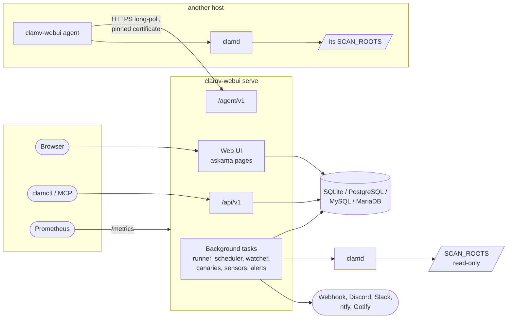

# Architecture

How clamv-webui is put together, for anyone changing it. What it does and how to run it are in the [README](../README.md); every setting is in [CONFIGURATION.md](CONFIGURATION.md).

## The short version

clamv-webui is one Rust binary that talks to ClamAV's `clamd` over its socket protocol. Run with `serve`, it is the web UI, the JSON API and every background task, with its state in a SQL database. Run with `agent` on another host, the same binary becomes a headless worker: it connects out to the server, takes jobs, scans with its own clamd and reports back. It never accepts connections.

## Binary and subcommands

| Command | What it does |
|---|---|
| `serve` (default) | Web UI, API, agent endpoints and every background task |
| `agent` | Headless worker for another host; no UI, no database, no users |
| `healthcheck` | Probes `/healthz` for the container `HEALTHCHECK` (the image has no curl) |
| `reset-admin` | Writes a new admin password to a file and prints only its path |
| `host-setup` | Run once as root with the host's `/` mounted; installs the fixed systemd units and polkit rule for managed checks and the firewall |

Every option is a flag or an environment variable (`crates/server/src/config.rs`, clap with `env`). Secrets also take a `*_FILE` form.

## Repository layout

| Path | Contents |
|---|---|
| `crates/clamd` | Async clamd client: PING, VERSION, STATS, MULTISCAN, INSTREAM over TCP or a Unix socket. Every call has connect, write and read timeouts and capped replies; a stream cut short by a limit is an error, never "clean". |
| `crates/server/src` | Everything else, one module per subsystem (table below) |
| `crates/server/templates`, `static` | askama templates (compile-time checked) and embedded CSS/JS/fonts (`rust-embed`) |
| `crates/server/migrations/{sqlite,postgres,mysql}` | Numbered SQL migrations per backend; MariaDB uses the MySQL set. `migrations.sha256` pins released files |
| `crates/server/i18n` | UI translation catalogs (`en.json` is the key set) |
| `crates/server/openapi/clamav-v1.yaml` | The API contract `clamctl` is built against |
| `crates/server/tests` | Integration tests against a fake clamd, on SQLite and, in CI, the other three databases |
| `cli/` | `clamctl`, a Go CLI and MCP server over `/api/v1` |
| `dashboards/` | Grafana dashboard, Prometheus scrape and alert examples |
| `examples/host-checks/` | The systemd units, scripts and polkit rule `host-setup` installs |
| `docker-compose*.yml` | Server with bundled clamd, server with an existing clamd, and an agent |

### Server modules

| Area | Modules |
|---|---|
| HTTP | `app` (state, router, security headers), `web/*` (pages), `api` and `api/agents` (JSON API), `agent` (agent endpoints), `metrics` |
| Auth | `auth/*`: `login` (the one password check), `lockout`, `ratelimit`, `password` (Argon2id; bcrypt verify-and-rehash), `totp`, `webauthn`, `oidc`, `ldap`, `external`, `sealed` (AES-256-GCM for stored seeds), `token`, `bootstrap`; `web/session` and `web/csrf` |
| Scanning | `scan` (path policy, runner, results), `cancel`, `schedule` + `cron`, `watch` + `fsevents` (inotify), `clamdconf` (ExcludePath), `quarantine` |
| Host sensors | `canary`, `integrity` (AIDE, rkhunter), `hostchecks` (managed units), `falco`, `crowdsec`, `firewall`, `timeline` (incidents) |
| Plumbing | `db/*`, `settings`, `config`, `tls`, `webhook`, `logging`, `i18n`, `timefmt`, `update` |

## A request, front to back

Layers, outermost first (`app::router`):

1. **Trace** and the **security headers** on every response: a CSP with no inline script or style, `frame-ancestors 'none'`, `nosniff`, a same-origin referrer and opener policy.
2. **`resolve_client`**: the client address is the socket peer. `X-Forwarded-For` and `-Proto` count only from `TRUSTED_PROXIES`.
3. **`check_host`**: with `PUBLIC_URL` set, other `Host` values are refused (`ALLOWED_HOSTS` adds more).
4. **`same_origin`**: every unsafe method must come from this origin (`Sec-Fetch-Site`, else `Origin` against `Host`).
5. **Route groups**, each with its own limits: pages and API (64 KiB bodies, `REQUEST_TIMEOUT_SECS`), uploads (streamed, capped per file at `CLAMD_MAX_STREAM_MB`), and agents (32 MiB, a timeout longer than the 25 s poll hold).

Handlers then check the role or scope themselves, and every signed-in form checks the session's CSRF token. Pages render through askama, so a template typo fails the build.

**Identity.** UI sessions are random ids stored hashed, with idle and absolute expiry, `HttpOnly; SameSite=Strict` cookies and `Secure` whenever TLS is on. The API takes a bearer token (scoped, optionally limited to endpoints, path roots and an expiry), HTTP Basic through the same throttled check as the login form (refused for accounts with a second factor), or the browser session plus `X-CSRF-TOKEN`. Roles are Viewer, Operator and Admin; OIDC and LDAP users get theirs from groups on every sign-in and are refused without one. A risky admin action (firewall apply, a new AIDE baseline, quarantine restore or delete) needs a fresh passkey assertion bound to that action and host.

## Jobs

Everything that scans or acts on a host is a row in `scan_jobs`.

| Kind | Made by | Runs |
|---|---|---|
| `UPLOAD` | Upload form, `POST /api/v1/scans/files` | In the request: streamed to clamd with INSTREAM, never written to disk |
| `PATH` | Path scan, schedule run | Local runner, or the agent named on the job |
| `WATCH` | Watched folder or real-time event | Local runner, or reported by an agent |
| `CONTROL` | Schedule with the EICAR control on | Streams EICAR first; a clamd that misses it fails the run |
| `HOSTCHECK`, `FIREWALL`, `QUARANTINE_*` | Admin actions on a host | That host's agent (or the server for itself), within its `AGENT_ALLOW` |

Status goes `QUEUED → RUNNING → FINISHED`, with a verdict of `OK`, `VIRUS_FOUND` or `ERROR` plus an error code. Two codes matter beyond display: `CANCELLED` (an operator stopped it; late results are refused) and `AGENT_LOST` (the server gave up on an offline agent; a late result reopens and finishes it).

**Runner** (`scan::start`). A dispatcher wakes on a notify or every 30 s, lists queued local jobs, takes a permit from a `SCAN_CONCURRENCY` semaphore, claims the job with a conditional `UPDATE` (so two loops never run one job) and runs it. A path scan resolves symlinks and must stay inside `SCAN_ROOTS`, then calls MULTISCAN; single files the app picks itself also honour clamd.conf `ExcludePath`. Results are trimmed to 1,000 stored lines with detections kept first. At start, jobs left `RUNNING` by a crash are marked interrupted.

**Finishing** goes through `scan::finish`, which writes the outcome only if the job is still open and reports `Saved`, `AlreadyFinished` or `Failed`. Detections also land in a `detections` table for the Detections page and the dashboard. Then come the audit entry, a structured log line with a stable `event` field, metrics and, for detections and failures, an alert.

**Cancel** (`cancel.rs`) finishes the job first, then stops a local scan through its oneshot, or wakes the agent's poll so it hears at once.

**Schedules** (`schedule.rs`) are checked every 30 s. A due schedule is claimed once and queued as PATH jobs, optionally preceded by the EICAR control. Cron fields and the optional scan window are read in the schedule's IANA zone; queued jobs from a run are dropped when its window closes. Missed runs collapse into one, a run is skipped while the previous one is still going, and a run for an offline agent logs `schedule.agent_offline` at once. Exclusions split a run into the folders and files around them (on an agent, only whole paths).

**Watched folders** (`watch.rs`) use inotify for files written on this machine and poll as a safety net. A file is recorded only after its scan finishes; failures retry after an hour, and files still being written wait.

## Agents

Agents are this binary on another host, next to that host's clamd. They exist so one UI covers many machines without opening ports on them.

**Transport.** The agent long-polls `POST /agent/v1/poll` (the server holds it up to 25 s), posts results to `/agent/v1/jobs/{id}/result` and events (real-time detections, canary hits, sensor reports) to `/agent/v1/events`. It authenticates with a bearer token the server stores hashed. HTTPS is required unless `AGENT_ALLOW_PLAINTEXT=true` is set on that host. The server certificate is trusted by SHA-256 pin (`AGENT_SERVER_FINGERPRINT`), by a CA file, or by the public roots; there is no skip-verify. The server's self-signed certificate lasts ten years, warns 60 days ahead, and a replacement is logged with both fingerprints and shown on Admin > Agents.

**Protocol.** Versioned JSON (`agent/proto.rs`, currently 2; the server also accepts 1). Each poll carries a heartbeat (version, clamd version, roots, free slots, the job kinds it runs) and gets back jobs plus ids to cancel. A kind the agent does not list fails with `AGENT_UNSUPPORTED`; a protocol the server does not speak gets 426 and shows as "version mismatch" with which side to update.

**Trust.** The agent enforces its own `SCAN_ROOTS` with `realpath`; the server only pre-checks against the roots the agent reported, to answer the UI quickly. What the server may ask for at all (`scan`, `canaries`, `checks`, `timers`, `baseline`, `firewall`, `quarantine`) is set only on the agent host (`AGENT_ALLOW`), and each kind is rate-limited and logged there. Decoy files are written only inside the agent's `CANARY_DIRS`. File contents never leave the agent, only verdicts and metadata. The server limits each agent to 1,200 events a minute, and the result endpoint caps and cleans what it stores.

**Outages.** Everything the agent sends goes through an ordered outbox (`agent/outbox.rs`) in memory or, with `AGENT_QUEUE_DIR`, one 0600 file per item, bounded at 5,000 items or 64 MB (the oldest is dropped and logged). Reports are trimmed to fit the server's body limit before queuing. Network errors, 401/403/408/426/429 and 503 (the server could not store it) are retried with backoff up to 60 s. Other 4xx answers are final. On the server, an agent is offline after 90 s without a poll. Its running jobs become `AGENT_LOST` after 10 minutes, and queued ones expire after a day.

## Host sensors

These read what the host already produces and feed the Timeline, Coverage page and alerts. Each runs on the server for itself and on every agent.

- **Canaries**: decoy files watched with inotify (watching never opens them). Any access is an ERROR log, an audit entry and an alert. With an auditd rule, the alert names the program and user.
- **Integrity**: AIDE and rkhunter report files, mounted read-only. Every new run is stored and a run with findings alerts. With `host-setup`, clamv can also start the fixed check units and switch their timers through polkit, still unprivileged.
- **Falco**: follows the JSON alert file; Error and worse notify, throttled per rule and host.
- **CrowdSec**: signs in to a Local API as a watcher and keeps alerts and decisions in memory (nothing in the database). Admins add or remove bans; very wide ranges and their own address are refused.
- **Firewall**: reads each host's nftables through a snapshot unit and writes only its own table through an apply unit. The unit tests the plan in an empty network namespace and rolls back after 90 s unless clamv reconnects.
- **Timeline**: merges all of the above with detections. Two different sensors on one host within an hour make an incident, logged and notified once.

## Alerts and observability

- **Logs** are the primary alert path. Every audit event, detection, limit hit and failure is a log line with a stable `event` field (`LOG_FORMAT=json` for shippers). Secrets and webhook URLs are never logged.
- **Webhooks** (`webhook.rs`) go to up to five destinations (JSON, Discord, Slack or Mattermost, ntfy, Gotify). Each request is pinned to an address that passed the SSRF policy, follows no redirects, and is tried up to three times.
- **Metrics** (`metrics.rs`): `/metrics` behind a bearer token, with the original Java metric names so existing dashboards keep working, plus per-agent gauges. clamd is sampled in the background, never per scrape.
- **Audit log**: every sign-in, setting change, scan, cancel and host action, with retention.

## Data

- **One `sqlx::AnyPool`** for SQLite (default), PostgreSQL, MySQL and MariaDB. The SQL is portable: `?` placeholders (rewritten for PostgreSQL), UUIDv7 text ids, unix-millisecond times and 0/1 booleans. Queries are checked at runtime, so CI runs the database tests on all four.
- **Migrations** are numbered per backend. A released file never changes; `migrations.sha256` and a CI step enforce that.
- **Settings**: a flag or environment variable wins, then the value saved on the Settings page, then the default. Security boundaries (scan roots, the clamd allowlist, TLS, the database) are deployment-only.
- **Secrets at rest**: passwords use Argon2id; session ids, API and agent tokens and recovery codes are stored as SHA-256; TOTP seeds are sealed with a key file kept outside the database.
- **`DATA_DIR`** (mode 0700) holds the SQLite file, the TLS material, the secret key and the one-time bootstrap password.

## Image and deployment

A static musl build on `rust:1-alpine`, shipped on `gcr.io/distroless/static-debian12:nonroot`: no shell, no package manager, no libc, no OpenSSL. It runs as UID 10001 in a read-only container with every capability dropped and a memory limit; only `/app/data` is writable. clamd runs in its own container (`clamav/clamav`) or wherever you already have it. Compose files use `:latest`; every build also gets a short commit tag for rollback, and releases add `:X.Y.Z` and `:X.Y`.

## clamctl and MCP

`cli/` is a Go module, `clamctl`, built only on `/api/v1` and the OpenAPI file. It scans files and paths (also on an agent), follows and cancels jobs, lists agents and manages schedules. `clamctl mcp` exposes the same calls as MCP tools for AI assistants, over stdio or an authenticated HTTP listener. See [CLI.md](CLI.md) and [MCP.md](MCP.md).

## Testing and CI

- `cargo test` runs unit tests and integration tests under `crates/server/tests` against a fake clamd and a temporary SQLite. `TEST_DATABASE_URLS` adds PostgreSQL, MySQL and MariaDB.
- CI (`.github/workflows/rust.yml`) runs fmt, clippy with `-D warnings`, the tests on all four databases, LDAP against a real OpenLDAP, the migration check, `cargo deny` (advisories and licences), CodeQL and Trivy. It builds the image and starts it once before anything is tagged.
- `clamctl.yml` runs `go vet`, the Go tests (with `-race`), cross-platform builds and an end-to-end run of `clamctl` and its MCP tools against a real server.

## Design rules

These hold across the code and are worth keeping:

- **Fail closed.** A limit hit, a truncated stream or an unreadable file is an error, never "clean". Unknown job kinds, roles and scopes are refused.
- **One check per concern.** One password check (`auth/login`), one path policy (`scan`), one SSRF policy (`webhook`), so a fix lands everywhere.
- **The host decides.** Agents enforce their own roots and permissions; the server cannot widen them. Privileged host actions go through fixed units on a polkit allow-list, never a shell.
- **Logs are the record.** Anything an operator might alert on has a stable `event` field.
- **No surprises on upgrade.** Released migrations, API fields, metric names and certificate fingerprints don't change under existing installs.
